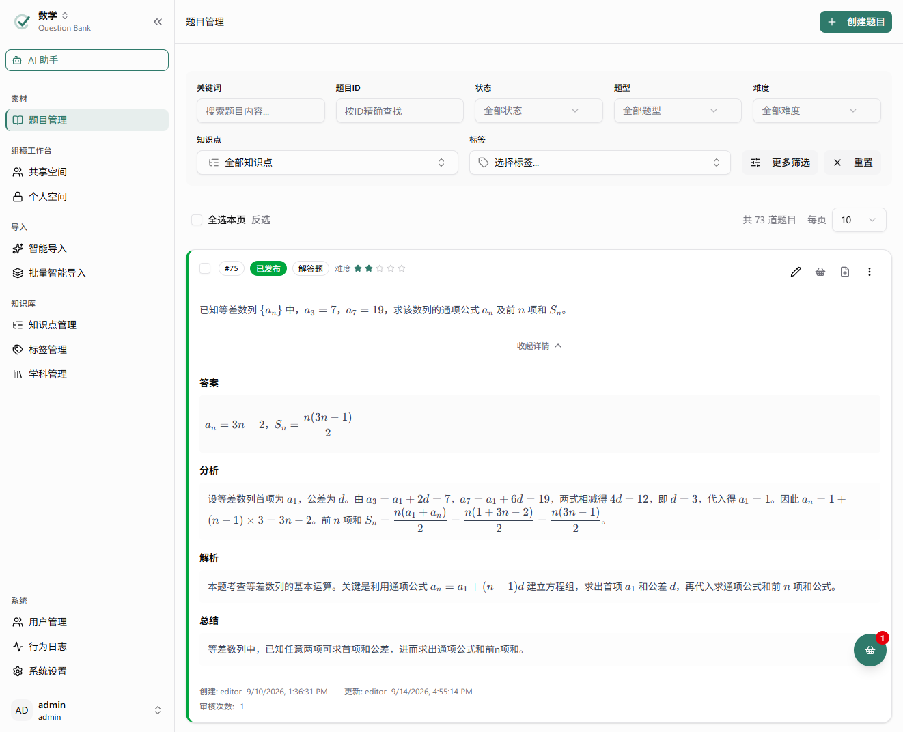
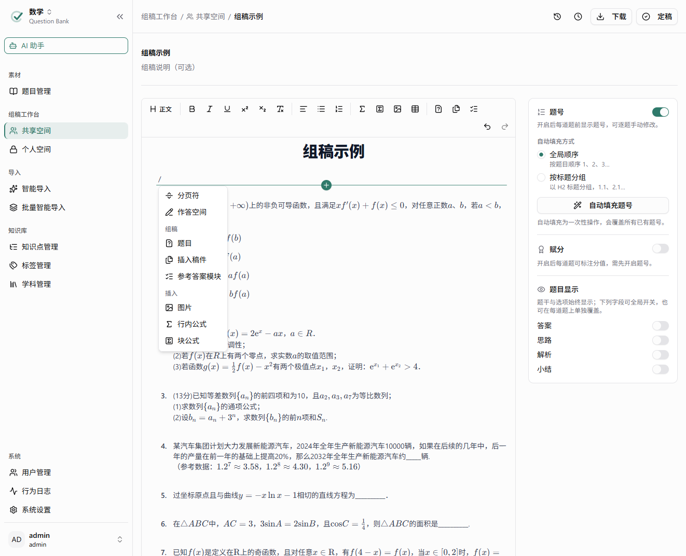

[简体中文](./README.md) | **English**

# QuestionBank — AI-Native Question Bank & Composition System

**QuestionBank** is an AI-native question bank and composition system for teachers and teaching research teams. It covers smart AI import, multi-subject question management, knowledge point matching, review and publishing, and composition layout. It ships as a Windows desktop app and as a server edition, so it works for individual use as well as for collaboration on a LAN or across a team.

## ✨ Key Features

| Module | Description |
| ------ | ------ |
| Compositions | Personal / shared spaces with folders, Question Basket collection, free layout with numbering / score / visibility controls, finalized snapshot versions, export to Word / LaTeX |
| Smart Import | Word / Markdown / images, plus .zip archives or whole folders with local images; AI extraction or precise tag-based parsing in three steps (upload → review → save). See [Smart Import](https://gygy-open.github.io/question-bank/en/features/import) |
| Question Bank | Multi-criteria filtering, bulk actions, knowledge point / tag linking, parent/child questions, rich text + tables + LaTeX, public / private visibility, soft delete |
| AI Assistant | Find questions and create compositions in chat, and propose changes to the current composition (add / remove / move / scores); changes are previewed first, and you apply or discard them |
| Knowledge Points | Tree-structured knowledge points per subject, vectorized for automatic RAG matching |
| Subjects & Permissions | Multiple subjects, per-subject Viewer / Editor / Manager roles, member management. See [Permissions & Roles](https://gygy-open.github.io/question-bank/en/admin/permissions) |
| Tags | Tag categories, bulk import from Excel |
| Review Workflow | Draft → Pending Review → Published → Archived, with a complete review log |
| AI Chat | Multi-model chat (with images), selectable provider / model, persistent chat history |
| Users & Sign-In | User management, sign-in statistics |
| Activity Logs | Global activity log with pagination and filters |
| System Settings | Hot-swappable AI provider / model configuration, prompt template management (super administrators only). See [AI Providers & Models](https://gygy-open.github.io/question-bank/en/admin/ai-config) |
| File Preview | Online preview of DOCX / Markdown source files |

## 🚀 Quick Start

We recommend downloading the **desktop edition**: a Windows tray app with the backend, frontend and an SQLite database built in. **No database or Docker required** — just run the installer.

1. Open [GitHub Releases](https://github.com/gygy-open/question-bank/releases) and download the latest `QuestionBank-Setup-x.y.z.exe`.
2. Run the installer and follow the wizard.
3. After installation, the app stays in the notification area as a **tray icon**. Right-click it → **Open QuestionBank** to start the setup wizard (create an administrator account), and you're ready to go.

All data is stored in `%APPDATA%\QuestionBank`. To back up, close the app and copy that folder.

Docs: [Installation & First Launch](https://gygy-open.github.io/question-bank/en/desktop/install) · [Personal Use](https://gygy-open.github.io/question-bank/en/desktop/personal)

## 🌐 Other Deployment Options

- **LAN sharing** — Turn on sharing in the desktop edition so colleagues on the same network can use it, with no extra deployment. See [LAN Sharing](https://gygy-open.github.io/question-bank/en/desktop/lan-sharing).
- **Server edition (Docker Compose)** — For team collaboration / production, with the full MySQL + ChromaDB stack. Pull the prebuilt images and start with one command; no local build needed. See [Docker Compose Deployment](https://gygy-open.github.io/question-bank/en/server/docker).

## 📚 Docs & Feedback

📖 Documentation: <https://gygy-open.github.io/question-bank/en/>

Questions and bug reports are welcome in [GitHub Issues](https://github.com/gygy-open/question-bank/issues).

## 📄 License

This project is licensed under [AGPL-3.0-or-later](./LICENSE). This means:

- ✅ Free to use, modify and distribute
- ✅ Commercial use allowed
- ⚠️ **If you provide it as a network service**, you must publish your modified source code
- ⚠️ Derivative works must use the same AGPL license

## 🤝 Contributing

Issues and pull requests are welcome. For the development environment, architecture and code conventions, see:

- [Contributing Guide](./CONTRIBUTING.md) (Chinese) · [Contributing (English docs)](https://gygy-open.github.io/question-bank/en/development/contributing)
- [Development Docs](https://gygy-open.github.io/question-bank/en/development/local-setup)
- [Architecture](https://gygy-open.github.io/question-bank/en/development/architecture)
