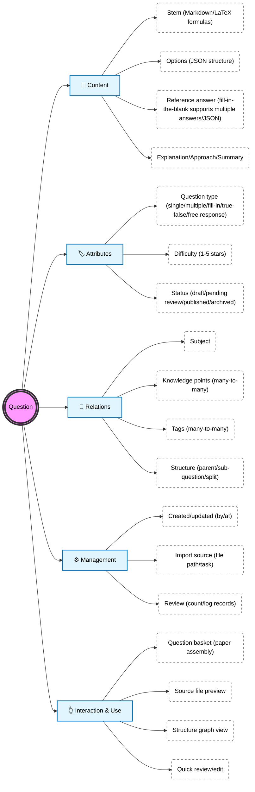
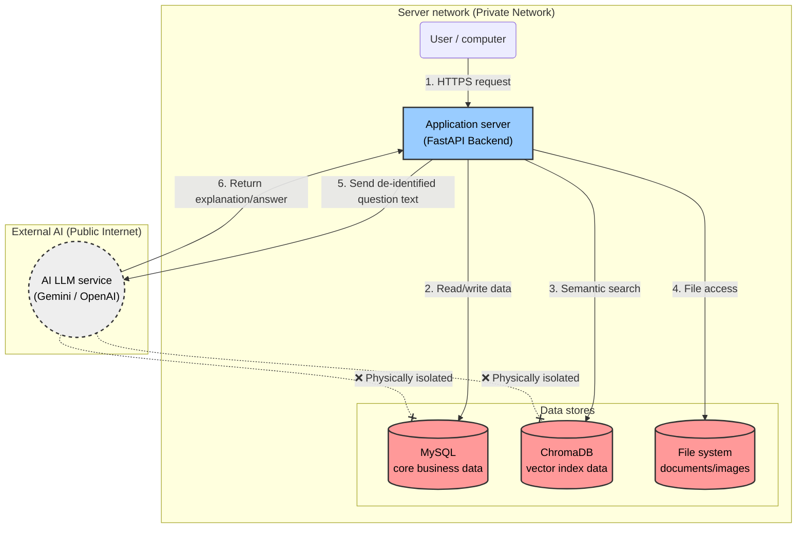
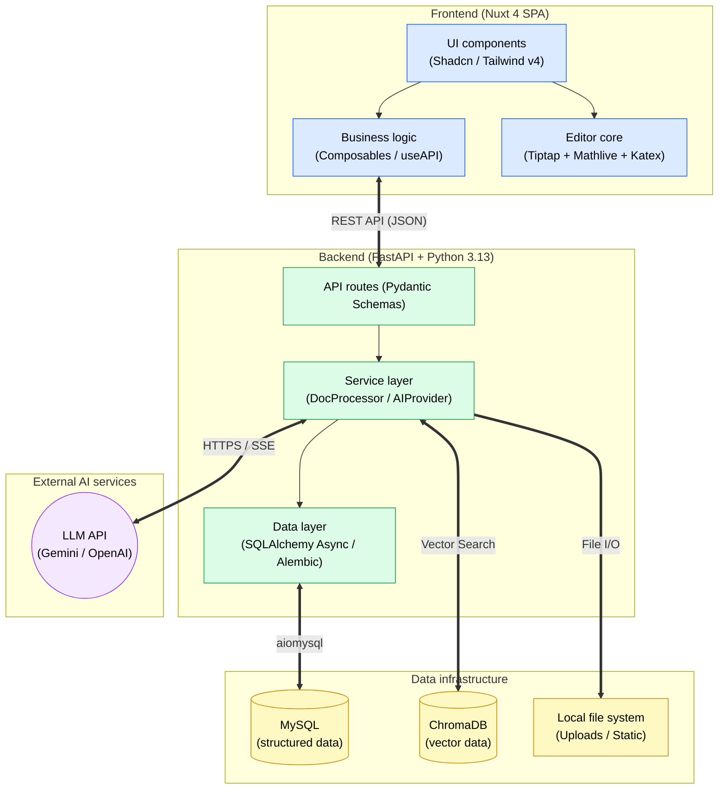
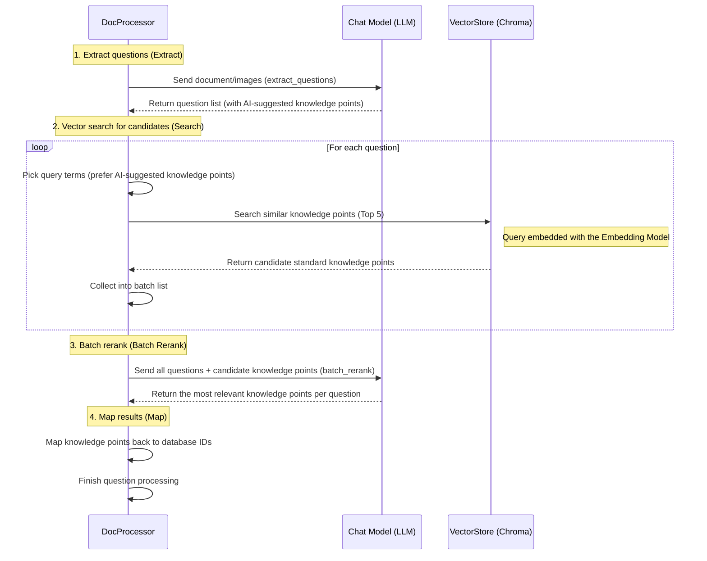

# Architecture

This page is for developers and deployers. It outlines the system's tech stack and layering.

## Tech Stack

| Layer | Technology |
|----|------|
| Backend | Python 3.13+, FastAPI, SQLAlchemy (Async), Alembic, Pydantic |
| Frontend | Nuxt 4 (SPA), Vue 3.5+, TypeScript, Tailwind CSS v4, Shadcn UI |
| AI | Multiple providers (Gemini / OpenAI-compatible), abstracted behind the `AIProvider` interface |
| Vector store | ChromaDB |
| Database | MySQL (Server edition) / SQLite (Desktop edition) |
| Packaging | Docker (Server edition), PyInstaller + Inno Setup (Desktop edition) |

## Component Relationships

```
                 ┌──────────────────┐
   Browser    →  │ Frontend Nuxt SPA │
                 └────────┬─────────┘
                          │ /api
                 ┌────────▼────────┐        ┌──────────────────────┐
                 │ Backend FastAPI  │  ───►  │ AI providers          │
                 └───┬────────┬────┘        │ Gemini / OpenAI-compat│
                     │        │             └──────────────────────┘
              ┌──────▼─────┐ ┌▼───────────┐
              │ Database    │ │ ChromaDB   │
              │MySQL/SQLite │ │ vectors    │
              └────▲───────┘ └▲───────────┘
                   │          │
              ┌────┴──────────┴────┐
              │ Worker (bg jobs)    │  ◄── enqueued by backend (imports, etc.)
              └────────────────────┘
```


## Layers and Key Modules

**Backend (`backend/app/`)**

- `api/` — routes (`api/v1/endpoints/*`)
- `crud/` — data access, inheriting from `crud/base.py:CRUDBase`
- `models/` — SQLAlchemy models
- `schemas/` — Pydantic models
- `services/` — business services, such as `ai_provider.py` (AI interface) and `doc_processor.py` (document parsing and extraction)
- `core/config.py` — static configuration
- `capabilities/` — business use cases (Capabilities) shared by REST, AI chat, the worker and MCP, with one set of authorization and logic; the entry point is recorded in `ExecutionContext.surface` (`api`/`chat`/`worker`/`mcp`)
- `mcp_server/` — MCP server (`/api/mcp`, same port as the API): API key auth middleware that maps Capabilities and read-only queries to MCP tools; see [MCP Access](/en/features/mcp)
- `worker.py` — background job processing

**Frontend (`frontend/app/`)**

- `pages/` — page routes
- `components/ui/` — UI components (Shadcn style)
- `composables/` — e.g. `useAPI`
- `plugins/api.ts` — API client (injects auth automatically)

## Deployment Modes and This Architecture

- **Desktop edition**: the frontend (static), backend, Worker and SQLite are all bundled into a single executable that runs as a tray app; ChromaDB is used locally.
- **Server edition**: each component runs in its own container (see [Docker Compose Deployment](/en/server/docker)).

## Database-Driven AI Configuration

AI providers, models and keys are stored in the database (`ai_providers`, `ai_models`, `user_ai_preferences`) rather than in environment variables, so they can be switched on the fly. An empty `ai_providers.owner_id` means a global provider; a non-empty one means a user's personal provider. Keys are stored encrypted (`app/core/secrets.py`). All callers resolve models through `app/services/ai_resolver.py` in the order "explicitly specified → personal default → global". To add a provider, implement the `AIProvider` interface in `app/services/ai_provider.py`.

## Diagrams

### Question Entity Overview

This diagram gives a full view of the core "Question" entity: its components, related information, and what it supports in the frontend.



### Security Architecture

This diagram shows how the system's components are isolated for security, keeping user data and privacy protected while still using external AI services to process questions.



### Technical Architecture

This diagram shows the overall tech stack and how modules interact, for developer reference.



### Knowledge Extraction Workflow

This diagram shows the optimized RAG (Retrieval-Augmented Generation) flow, in particular the batch reranking mechanism.


